


<table>
<tr>
<td width="50%"><a href="https://github.com/Jenish-Shobhit/incident-response-agent"></a></td>
<td width="50%"><a href="https://github.com/Jenish-Shobhit/codeMap"></a></td>
</tr>
<tr>
<td align="center"><a href="https://dpdduyx82d5bu.cloudfront.net">Live replay</a> &nbsp;·&nbsp; <a href="https://github.com/Jenish-Shobhit/incident-response-agent">Source</a></td>
<td align="center"><a href="https://github.com/Jenish-Shobhit/codeMap/releases/latest">Release</a> &nbsp;·&nbsp; <a href="https://github.com/Jenish-Shobhit/codeMap">Source</a></td>
</tr>
<tr>
<td><a href="https://github.com/Jenish-Shobhit/paneflo">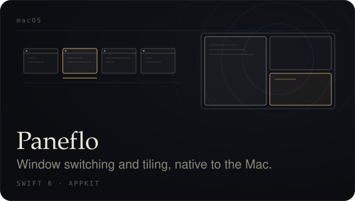</a></td>
<td><a href="https://github.com/Jenish-Shobhit/margin">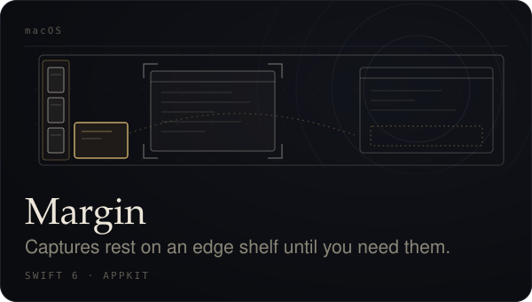</a></td>
</tr>
<tr>
<td align="center"><a href="https://jenish-shobhit.github.io/Paneflo/">Download</a> &nbsp;·&nbsp; <a href="https://github.com/Jenish-Shobhit/paneflo">Source</a></td>
<td align="center"><a href="https://jenish-shobhit.github.io/margin/">Download</a> &nbsp;·&nbsp; <a href="https://github.com/Jenish-Shobhit/margin">Source</a></td>
</tr>
<tr>
<td><a href="https://jenish-shobhit.github.io/visual-dsa/"></a></td>
<td><a href="https://chromewebstore.google.com/detail/jejlhdamaodimmhcomnihmepididhbde"></a></td>
</tr>
<tr>
<td align="center"><a href="https://jenish-shobhit.github.io/visual-dsa/">Open the course</a> &nbsp;·&nbsp; <a href="https://github.com/Jenish-Shobhit/visual-dsa">Source</a></td>
<td align="center"><a href="https://chromewebstore.google.com/detail/jejlhdamaodimmhcomnihmepididhbde">Chrome Web Store</a> &nbsp;·&nbsp; <a href="https://github.com/Jenish-Shobhit/learntube">Source</a></td>
</tr>
<tr>
<td><a href="https://github.com/Jenish-Shobhit/paneMorph"></a></td>
<td><a href="https://jenish-shobhit.github.io/pyspark-three-ways/">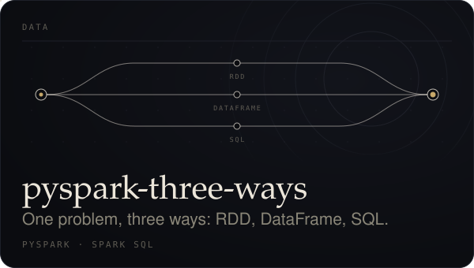</a></td>
</tr>
<tr>
<td align="center"><a href="https://github.com/Jenish-Shobhit/paneMorph/releases/latest">Release</a> &nbsp;·&nbsp; <a href="https://github.com/Jenish-Shobhit/paneMorph">Source</a></td>
<td align="center"><a href="https://jenish-shobhit.github.io/pyspark-three-ways/">Notes</a> &nbsp;·&nbsp; <a href="https://github.com/Jenish-Shobhit/pyspark-three-ways">Source</a></td>
</tr>
</table>

 

Earlier &nbsp;·&nbsp; <a href="https://github.com/Jenish-Shobhit/Learning-Management-System">Learning Management System</a> (Spring Boot, MySQL) &nbsp;·&nbsp; <a href="https://github.com/Jenish-Shobhit/smart-home">smart-home</a> (C++, Arduino)

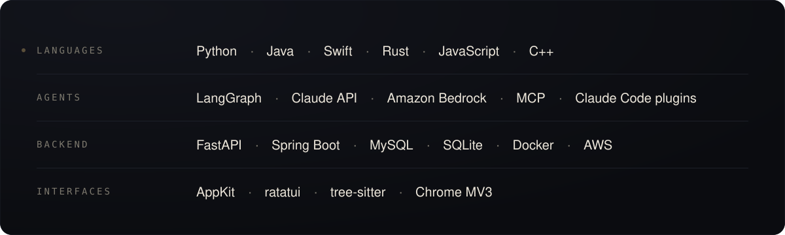

  

Anthropic Claude Certified Architect, Foundations &nbsp;·&nbsp; Infosys Certified Generative AI Professional

  


