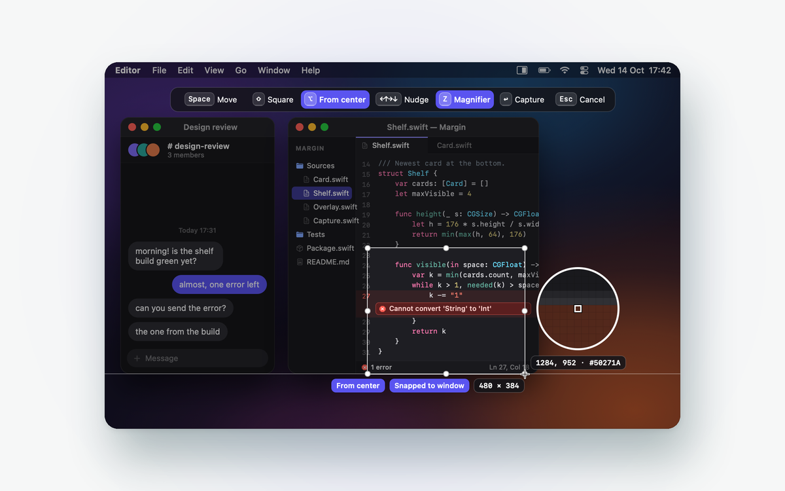
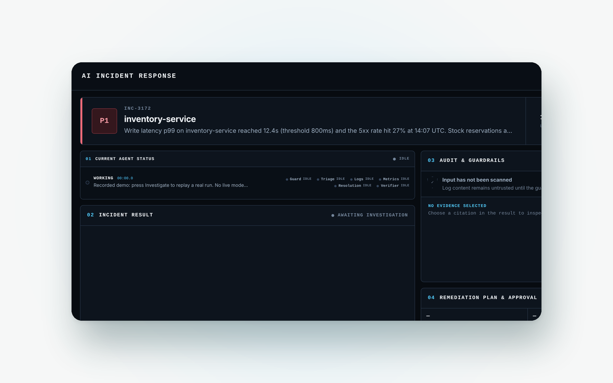
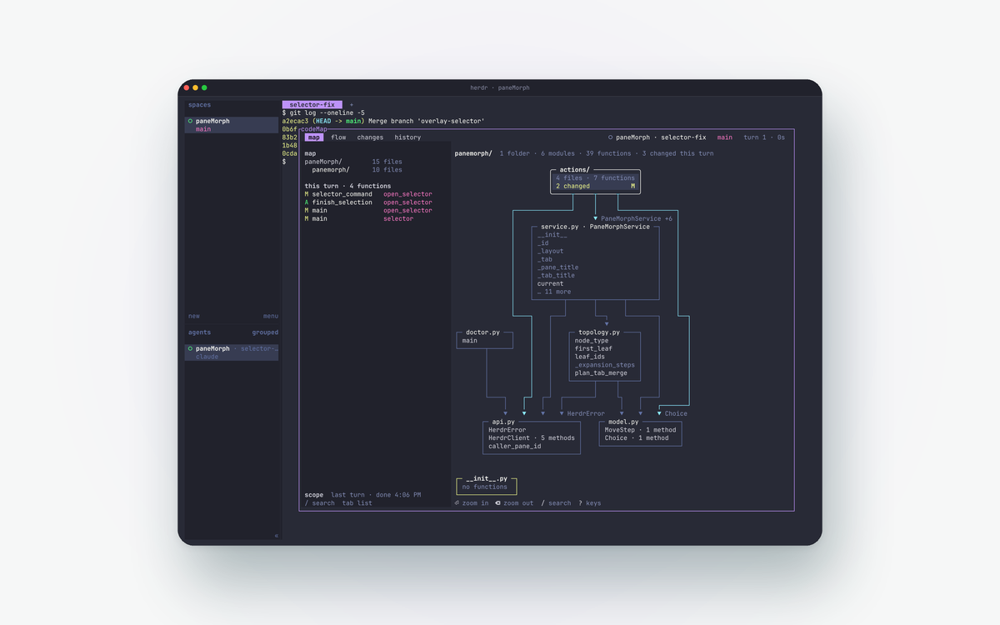
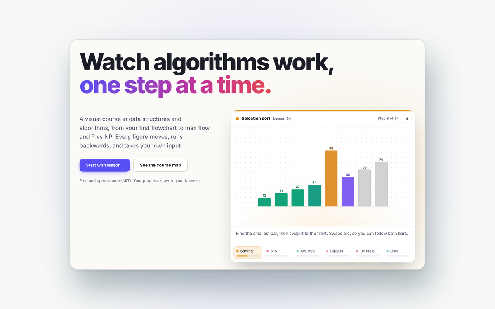
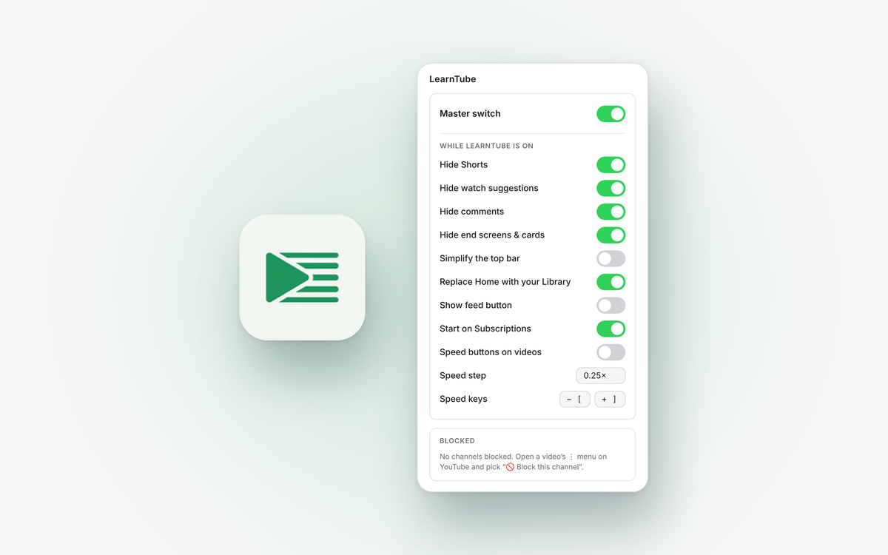
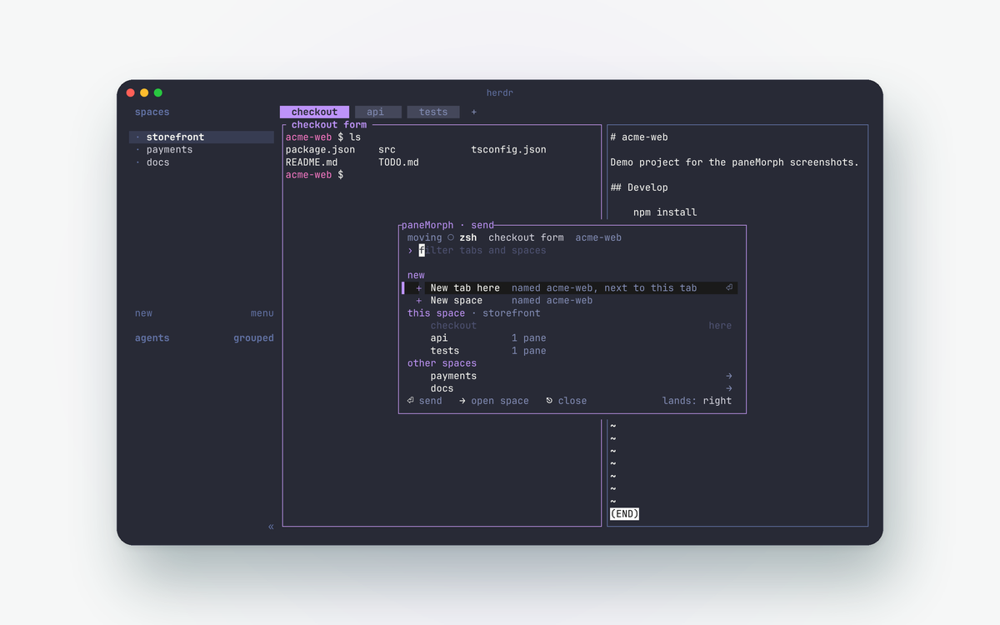
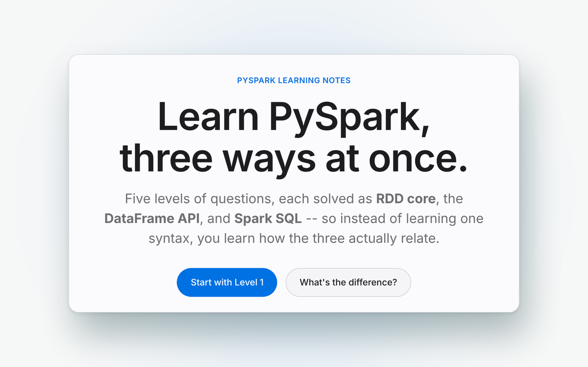

<picture>
  <source media="(prefers-color-scheme: dark)" srcset="assets/hero-dark.svg">
  
</picture>

  <a href="mailto:jenshobhit@gmail.com"><strong>Email</strong></a> ·
  <a href="https://www.linkedin.com/in/jenish-shobhit/">LinkedIn</a> ·
  <a href="https://www.credly.com/badges/3113b5a8-1f0c-42d1-91b8-78d5d4799aab">Claude Certified Architect</a>

 

<table>
<tr>
<td width="50%" valign="top">
<a href="https://github.com/Jenish-Shobhit/paneflo"><picture><source media="(prefers-color-scheme: dark)" srcset="assets/previews/paneflo-dark.png"></picture></a>

### Paneflo
**Every window. In its place.** A window switcher, tiling and an organized Overview in one native macOS menu bar app. 
Swift 6 · AppKit · macOS 26

[Download](https://jenish-shobhit.github.io/paneflo/) · [Source](https://github.com/Jenish-Shobhit/paneflo)
</td>
<td width="50%" valign="top">
<a href="https://github.com/Jenish-Shobhit/margin"><picture><source media="(prefers-color-scheme: dark)" srcset="assets/previews/margin-dark.png"></picture></a>

### Margin
**Screenshots that wait in the margin.** Every capture rests on a shelf at the edge of the screen until you drag it where it belongs. 
Swift 6 · AppKit · macOS 26

[Download](https://jenish-shobhit.github.io/margin/) · [Source](https://github.com/Jenish-Shobhit/margin)
</td>
</tr>
<tr>
<td width="50%" valign="top">
<a href="https://github.com/Jenish-Shobhit/incident-response-agent"><picture><source media="(prefers-color-scheme: dark)" srcset="assets/previews/incident-dark.png"></picture></a>

### Incident Response Agent
**Parallel investigators. Cited conclusions. A human approves.** Injected instructions in logs are quarantined before any model reads them. 
Python · LangGraph · FastAPI · Claude

[Live demo](https://dpdduyx82d5bu.cloudfront.net) · [Source](https://github.com/Jenish-Shobhit/incident-response-agent)
</td>
<td width="50%" valign="top">
<a href="https://github.com/Jenish-Shobhit/codeMap"><picture><source media="(prefers-color-scheme: dark)" srcset="assets/previews/codemap-dark.png"></picture></a>

### codeMap
**See your code as a map, and what your agents changed on it.** A herdr plugin. Read-only: no refs, no stash, no index writes. 
Rust · ratatui · tree-sitter

[Release](https://github.com/Jenish-Shobhit/codeMap/releases/latest) · [Source](https://github.com/Jenish-Shobhit/codeMap)
</td>
</tr>
<tr>
<td width="50%" valign="top">
<a href="https://jenish-shobhit.github.io/visual-dsa/"><picture><source media="(prefers-color-scheme: dark)" srcset="assets/previews/visualdsa-dark.png"></picture></a>

### Visual DSA
**Watch algorithms work.** 38 lessons in 7 units. Every lab runs backwards and shows the running line in pseudocode, JavaScript and Python. 
HTML · CSS · JavaScript · no build step

[Open the course](https://jenish-shobhit.github.io/visual-dsa/) · [Source](https://github.com/Jenish-Shobhit/visual-dsa)
</td>
<td width="50%" valign="top">
<a href="https://chromewebstore.google.com/detail/jejlhdamaodimmhcomnihmepididhbde"><picture><source media="(prefers-color-scheme: dark)" srcset="assets/previews/learntube-dark.png"></picture></a>

### LearnTube
**Turn YouTube into a calm place to learn.** Hides Shorts and clutter, adds a library and progress tracking. No tracking, no dependencies. 
Chrome extension · Manifest V3

[Chrome Web Store](https://chromewebstore.google.com/detail/jejlhdamaodimmhcomnihmepididhbde) · [Source](https://github.com/Jenish-Shobhit/learntube)
</td>
</tr>
<tr>
<td width="50%" valign="top">
<a href="https://github.com/Jenish-Shobhit/paneMorph"><picture><source media="(prefers-color-scheme: dark)" srcset="assets/previews/panemorph-dark.png"></picture></a>

### paneMorph
**Send any pane anywhere. Fetch any pane here.** A herdr plugin that moves live terminal panes between tabs and spaces. Processes keep running. 
Rust · ratatui

[Release](https://github.com/Jenish-Shobhit/paneMorph/releases/latest) · [Source](https://github.com/Jenish-Shobhit/paneMorph)
</td>
<td width="50%" valign="top">
<a href="https://jenish-shobhit.github.io/pyspark-three-ways/"><picture><source media="(prefers-color-scheme: dark)" srcset="assets/previews/pyspark-dark.png"></picture></a>

### PySpark, Three Ways
**The same questions, solved three times.** As RDD core, as the DataFrame API and as Spark SQL, so the three line up side by side. 
PySpark · Spark SQL

[Notes](https://jenish-shobhit.github.io/pyspark-three-ways/) · [Source](https://github.com/Jenish-Shobhit/pyspark-three-ways)
</td>
</tr>
</table>

Earlier: [Learning Management System](https://github.com/Jenish-Shobhit/Learning-Management-System) (Spring Boot, MySQL) · [smart-home](https://github.com/Jenish-Shobhit/smart-home) (C++ on Arduino)

 

| | |
|:--|:--|
| **Languages** | Python · Java · Swift · Rust · JavaScript · C++ |
| **Agents** | LangGraph · Claude API · Amazon Bedrock · MCP · Claude Code plugins |
| **Backend** | FastAPI · Spring Boot · MySQL · SQLite · Docker · AWS |
| **Interfaces** | AppKit · ratatui · tree-sitter · Chrome extensions |
| **Certified** | [Anthropic Claude Certified Architect, Foundations](https://www.credly.com/badges/3113b5a8-1f0c-42d1-91b8-78d5d4799aab) · Infosys Certified Generative AI Professional |

 

  <a href="mailto:jenshobhit@gmail.com"><picture><source media="(prefers-color-scheme: dark)" srcset="assets/btn-email-dark.svg"></picture></a>
  &nbsp;
  <a href="https://www.linkedin.com/in/jenish-shobhit/"><picture><source media="(prefers-color-scheme: dark)" srcset="assets/btn-linkedin-dark.svg"></picture></a>

