<picture>
  <source media="(prefers-color-scheme: dark)" srcset="assets/hero-dark.svg">
  
</picture>

 

<table width="100%">
<tr>
<td width="22%" valign="top"><b>NOW</b></td>
<td width="78%" valign="top">
I build agents that show their evidence, and the backend that keeps them honest. Digital Specialist Engineer at Infosys. Before that, Java and Spring Boot at Cognizant.
</td>
</tr>
<tr>
<td width="22%" valign="top"><b>BUILDING</b></td>
<td width="78%" valign="top">

01&nbsp;&nbsp;**[Agentic Incident Response](https://github.com/Jenish-Shobhit/incident-response-agent)** Python · FastAPI · LangGraph 
Multi-agent incident investigation: parallel investigators, every conclusion cited to evidence, prompt-injection quarantine, and a human approval gate before anything is final. **[Live demo](https://dpdduyx82d5bu.cloudfront.net)**

02&nbsp;&nbsp;**[LearnTube](https://github.com/Jenish-Shobhit/learntube)** Chrome extension · Manifest V3 · vanilla JS 
Distraction-free YouTube for learning: nine switches that hide Shorts and clutter. Collects nothing. **[On the Chrome Web Store](https://chromewebstore.google.com/detail/jejlhdamaodimmhcomnihmepididhbde)**

03&nbsp;&nbsp;**Care** MCP server · Claude Code plugin · in progress 
An agent that remembers the people you love, their dates and their likes, and drafts the right wish at the right time. Local first. Repo opens when v0 runs.
<!-- when public: https://github.com/Jenish-Shobhit/care -->

</td>
</tr>
<tr>
<td width="22%" valign="top"><b>ALSO</b></td>
<td width="78%" valign="top">

**[paneMorph](https://github.com/Jenish-Shobhit/paneMorph)** &nbsp;Move live Herdr panes between tabs without restarting their processes. A Herdr plugin. 
**design-atlas** &nbsp;151 aesthetics and 47 capabilities: a design-selection system for AI agents. Publishing. 
**visual-dsa** &nbsp;A visual guide to data structures and algorithms, starting from what code is. Writing. 
**[Smart_Home](https://github.com/Jenish-Shobhit/Smart_Home)** &nbsp;Arduino controller in C++: password access, sensors, servo door and window.
<!-- when public: https://github.com/Jenish-Shobhit/design-atlas · https://github.com/Jenish-Shobhit/visual-dsa -->

</td>
</tr>
<tr>
<td width="22%" valign="top"><b>STACK</b></td>
<td width="78%" valign="top">
Python · Java · JavaScript · FastAPI · LangGraph · Spring Boot · MySQL · SQLite · Docker · AWS · MCP · Chrome extensions · C++ on Arduino
</td>
</tr>
<tr>
<td width="22%" valign="top"><b>CERTIFIED</b></td>
<td width="78%" valign="top">

<b>Anthropic Claude Certified Architect, Foundations</b> 
Verified on Credly. Plus Infosys Certified Generative AI Professional, Foundation to Intermediate.
</td>
</tr>
<tr>
<td width="22%" valign="top"><b>REACH</b></td>
<td width="78%" valign="top">
<a href="mailto:jenshobhit@gmail.com">jenshobhit@gmail.com</a> &nbsp;·&nbsp; <a href="https://www.linkedin.com/in/jenish-shobhit/">linkedin.com/in/jenish-shobhit</a> &nbsp;·&nbsp; Hyderabad, India
</td>
</tr>
</table>

 &nbsp;Every claim on this page traces to a repository you can read.
