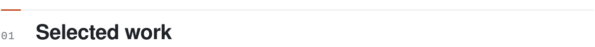
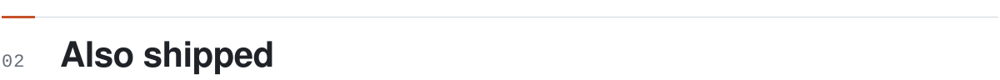
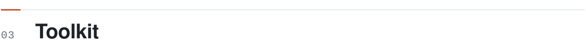
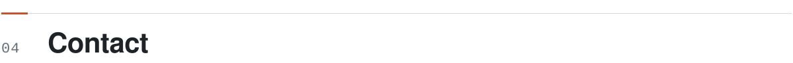
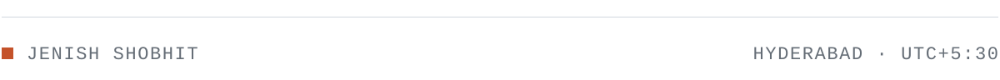

<picture>
  <source media="(prefers-color-scheme: dark)" srcset="assets/hero-dark.svg">
  
</picture>

Digital Specialist Engineer at Infosys. Outside the day job I ship small, finished tools: agents with an audit trail, terminal plugins for agent workflows, and native macOS apps. Everything below is public and built; most of it you can run in one click.

 

<picture>
  <source media="(prefers-color-scheme: dark)" srcset="assets/section-selected-work-dark.svg">
  
</picture>

<table>
<tr>
<td width="50%" valign="top">

### [Incident Response Agent](https://github.com/Jenish-Shobhit/incident-response-agent)
PYTHON · LANGGRAPH · FASTAPI · CLAUDE / BEDROCK

Parallel investigators read logs and metrics; every claim must cite evidence or it is dropped. Injected instructions in logs are quarantined, and nothing runs without a human approval gate.

**[Live replay →](https://dpdduyx82d5bu.cloudfront.net)**

</td>
<td width="50%" valign="top">

### [codeMap](https://github.com/Jenish-Shobhit/codeMap)
RUST · RATATUI · TREE-SITTER · HERDR PLUGIN

Shows a coding agent's worktree as a map, a function as a flowchart, and its last turn as a reviewable diff. Strictly read-only: no refs, no stash, no index writes.

**[v0.1.0 release →](https://github.com/Jenish-Shobhit/codeMap/releases/latest)**

</td>
</tr>
<tr>
<td width="50%" valign="top">

### [Paneflo](https://github.com/Jenish-Shobhit/paneflo)
SWIFT 6 · APPKIT · CORE ANIMATION · macOS

A per-window ⌘Tab switcher with live previews, snap-to-edge tiling and a stable Overview. Benchmarked: snap-outline latency cut from 15.5&nbsp;ms to 2.2&nbsp;ms mean.

**[Download →](https://jenish-shobhit.github.io/Paneflo/)**

</td>
<td width="50%" valign="top">

### [Margin](https://github.com/Jenish-Shobhit/margin)
SWIFT 6 · APPKIT · H.264 / AAC · macOS

Screenshots and screen recordings wait on an edge shelf until you drag them where they belong. ⌘V pastes the image straight into Claude Code or Ghostty.

**[Download →](https://jenish-shobhit.github.io/margin/)**

</td>
</tr>
<tr>
<td width="50%" valign="top">

### [Visual DSA](https://github.com/Jenish-Shobhit/visual-dsa)
HTML · CSS · JAVASCRIPT · NO FRAMEWORK

38 lessons of data structures and algorithms as running labs you can step backwards, with the code shown in pseudocode, JavaScript and Python. Every algorithm is tested.

**[Open the course →](https://jenish-shobhit.github.io/visual-dsa/)**

</td>
<td width="50%" valign="top">

### [LearnTube](https://github.com/Jenish-Shobhit/learntube)
CHROME EXTENSION · MANIFEST V3 · VANILLA JS

YouTube for learning: strips Shorts and clutter, and adds a learning library, progress tracking and a subscriptions inbox. Collects no data.

**[Chrome Web Store →](https://chromewebstore.google.com/detail/jejlhdamaodimmhcomnihmepididhbde)**

</td>
</tr>
</table>

 

<picture>
  <source media="(prefers-color-scheme: dark)" srcset="assets/section-also-shipped-dark.svg">
  
</picture>

**[paneMorph](https://github.com/Jenish-Shobhit/paneMorph)** &nbsp;RUST 
Move live terminal panes between Herdr tabs and spaces with two keys, without restarting their processes. Undo included.

**[pyspark-three-ways](https://github.com/Jenish-Shobhit/pyspark-three-ways)** &nbsp;PYSPARK 
The same Spark exercises solved as RDDs, DataFrames and Spark SQL, side by side. **[Notes →](https://jenish-shobhit.github.io/pyspark-three-ways/)**

**[Learning Management System](https://github.com/Jenish-Shobhit/Learning-Management-System)** &nbsp;JAVA · SPRING BOOT 
Spring Boot and MySQL prototype covering courses, enrolments, progress and quizzes.

**[smart-home](https://github.com/Jenish-Shobhit/smart-home)** &nbsp;C++ · ARDUINO 
Arduino controller with keypad access, sensor alarms and a servo-driven door and window.

 

<picture>
  <source media="(prefers-color-scheme: dark)" srcset="assets/section-toolkit-dark.svg">
  
</picture>

<table>
<tr><td width="22%"><b>LANGUAGES</b></td><td>Python · Java · Swift · Rust · JavaScript · C++</td></tr>
<tr><td><b>AGENTS</b></td><td>LangGraph · Claude API · Amazon Bedrock · MCP · Claude Code plugins</td></tr>
<tr><td><b>BACKEND</b></td><td>FastAPI · Spring Boot · MySQL · SQLite · Docker · AWS</td></tr>
<tr><td><b>INTERFACES</b></td><td>AppKit · ratatui · tree-sitter · Chrome extensions · plain web</td></tr>
<tr><td><b>CERTIFIED</b></td><td><b>Anthropic Claude Certified Architect, Foundations</b> Verified on Credly · also Infosys Certified Generative AI Professional</td></tr>
</table>

 

<picture>
  <source media="(prefers-color-scheme: dark)" srcset="assets/section-contact-dark.svg">
  
</picture>

Open to conversations about agent reliability, backend systems and developer tooling.

**[jenshobhit@gmail.com](mailto:jenshobhit@gmail.com)** &nbsp;·&nbsp; **[LinkedIn](https://www.linkedin.com/in/jenish-shobhit/)** &nbsp;·&nbsp; Hyderabad, India

 

<picture>
  <source media="(prefers-color-scheme: dark)" srcset="assets/footer-dark.svg">
  
</picture>
