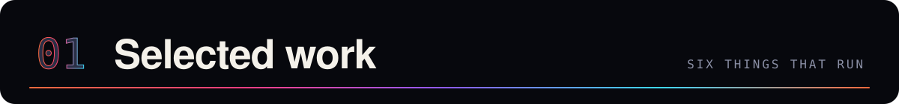
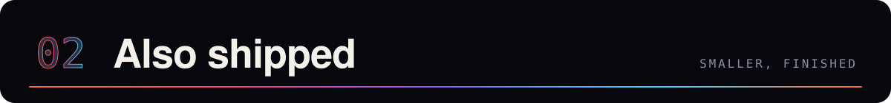
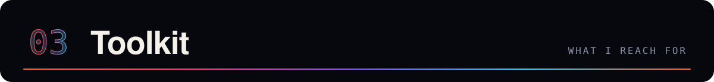
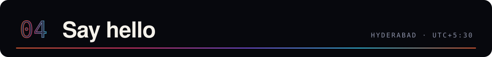

  

  

<table>
<tr>
<td width="50%"></td>
<td width="50%"></td>
</tr>
<tr>
<td align="center"><a href="https://dpdduyx82d5bu.cloudfront.net"><b>Live replay</b></a> · <a href="https://github.com/Jenish-Shobhit/incident-response-agent">Source</a></td>
<td align="center"><a href="https://github.com/Jenish-Shobhit/codeMap/releases/latest"><b>Release</b></a> · <a href="https://github.com/Jenish-Shobhit/codeMap">Source</a></td>
</tr>
<tr>
<td></td>
<td></td>
</tr>
<tr>
<td align="center"><a href="https://jenish-shobhit.github.io/Paneflo/"><b>Download</b></a> · <a href="https://github.com/Jenish-Shobhit/paneflo">Source</a></td>
<td align="center"><a href="https://jenish-shobhit.github.io/margin/"><b>Download</b></a> · <a href="https://github.com/Jenish-Shobhit/margin">Source</a></td>
</tr>
<tr>
<td></td>
<td></td>
</tr>
<tr>
<td align="center"><a href="https://jenish-shobhit.github.io/visual-dsa/"><b>Open the course</b></a> · <a href="https://github.com/Jenish-Shobhit/visual-dsa">Source</a></td>
<td align="center"><a href="https://chromewebstore.google.com/detail/jejlhdamaodimmhcomnihmepididhbde"><b>Chrome Web Store</b></a> · <a href="https://github.com/Jenish-Shobhit/learntube">Source</a></td>
</tr>
</table>

 

  

| | |
|:--|:--|
| **[paneMorph](https://github.com/Jenish-Shobhit/paneMorph)**  RUST · HERDR PLUGIN | Move live terminal panes between tabs and spaces with two keys, without restarting their processes. Undo included. |
| **[pyspark-three-ways](https://github.com/Jenish-Shobhit/pyspark-three-ways)**  PYSPARK | The same Spark exercises solved as RDDs, DataFrames and Spark SQL, side by side. [Notes →](https://jenish-shobhit.github.io/pyspark-three-ways/) |
| **[Learning Management System](https://github.com/Jenish-Shobhit/Learning-Management-System)**  JAVA · SPRING BOOT | Spring Boot and MySQL prototype covering courses, enrolments, progress and quizzes. |
| **[smart-home](https://github.com/Jenish-Shobhit/smart-home)**  C++ · ARDUINO | Arduino controller with keypad access, sensor alarms and a servo-driven door and window. |

 

  

  

**Anthropic Claude Certified Architect, Foundations** 
Verified on Credly · also Infosys Certified Generative AI Professional

 

  

&nbsp;
&nbsp;

  

